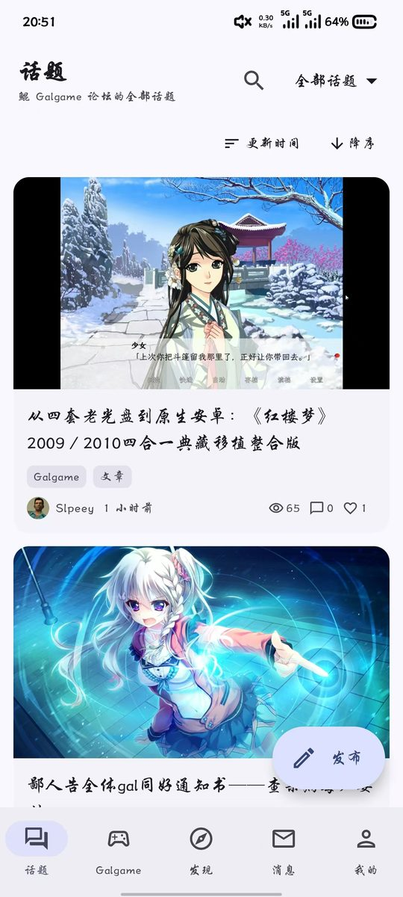
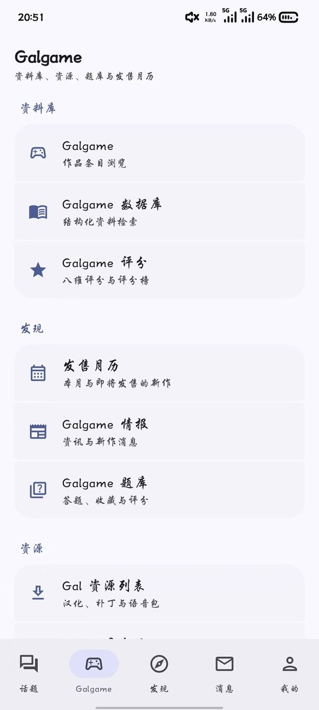
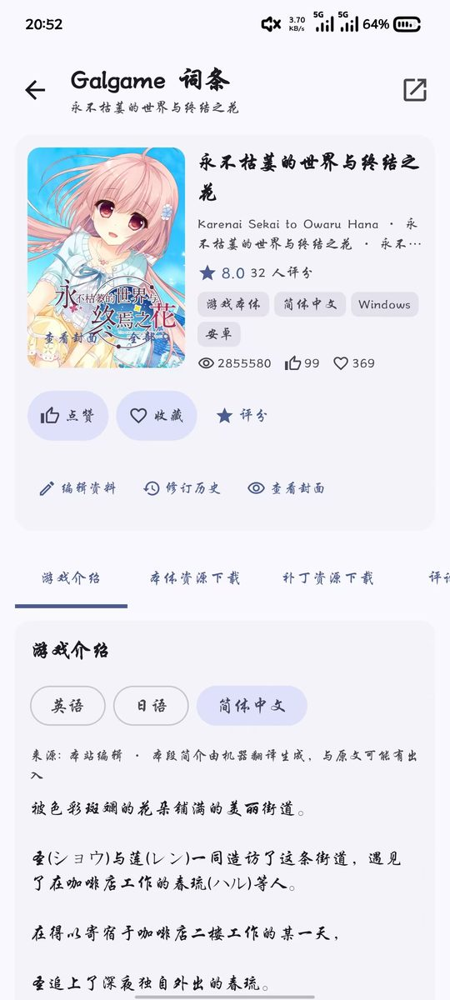
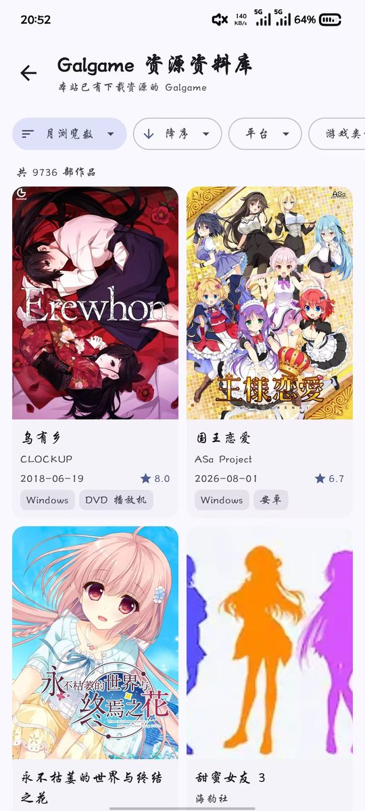
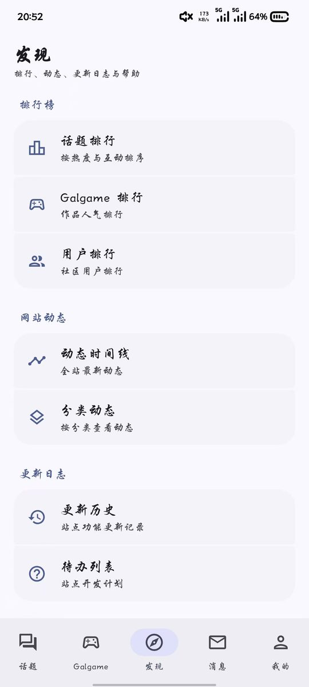
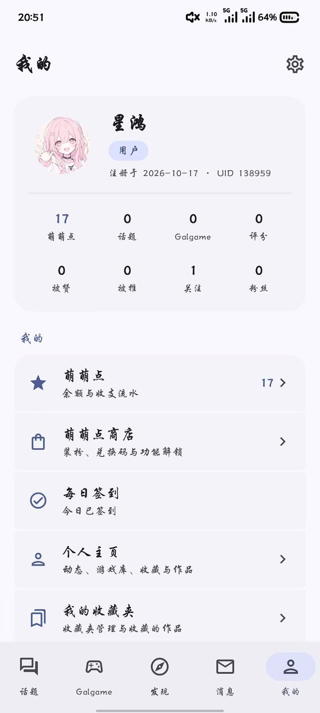
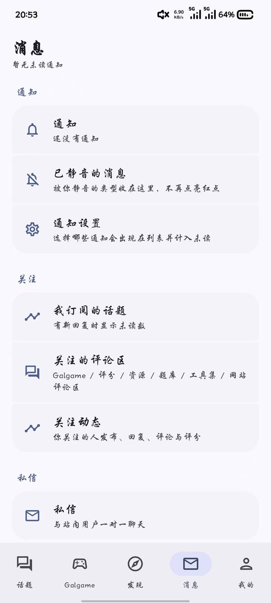
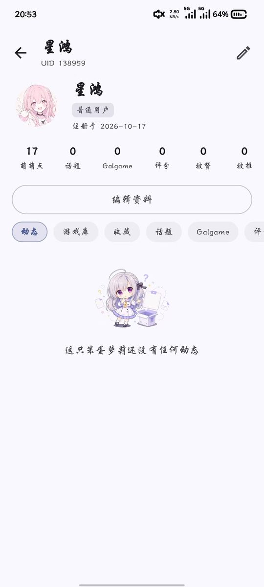
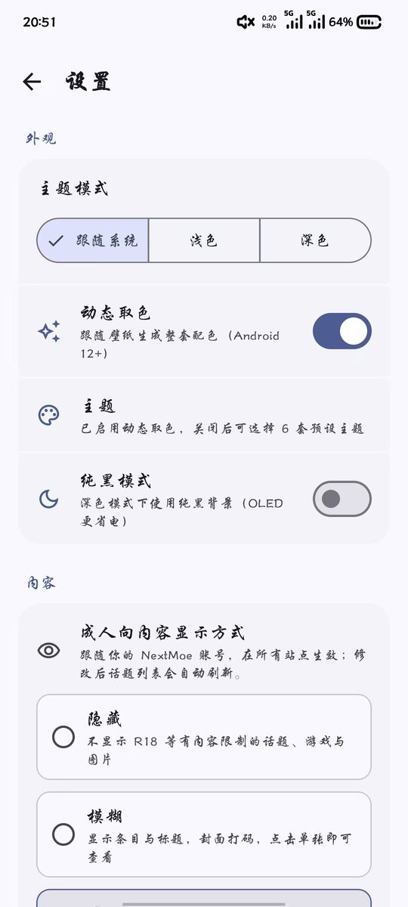

# kungal · 鲲 Galgame 论坛安卓客户端

[](https://developer.android.com)
[](https://kotlinlang.org)
[](https://developer.android.com/jetpack/compose)
[](#测试)
[](LICENSE)

[kungal.com](https://www.kungal.com)（鲲 Galgame 论坛）的**非官方**安卓第三方客户端。
使用 Kotlin + Jetpack Compose 编写，界面为原生 Compose，不是网页套壳。

> 本项目与鲲 Galgame 论坛官方无隶属、合作或代理关系。站点名称、图标及相关内容的权利归站点及原作者所有。

## 界面截图

| 话题 | Galgame 频道 | 词条详情 |
| :-: | :-: | :-: |
|  |  |  |

| Galgame 资料库 | 发现 | 我的 |
| :-: | :-: | :-: |
|  |  |  |

| 消息与私信 | 用户主页 | 设置 |
| :-: | :-: | :-: |
|  |  |  |

## 功能

对照网站逐项实现。按官方 OpenAPI 统计，普通用户面接口覆盖约 **87%**，剩余缺口与计划见
[`docs/接口覆盖缺口-2026-10-18.md`](docs/接口覆盖缺口-2026-10-18.md)。

### 话题与讨论

- 首页话题流、分类与版块切换、话题搜索
- 话题详情：Markdown 正文、图片、表格、剧透、楼中楼评论
- 发帖、编辑、草稿、图片上传
- 回复与评论：引用、编辑、删除、置顶、最佳答案
- reaction、收藏、订阅、推、隐藏、已读
- 投票与抽奖：浏览、投票、参与、结果与中奖兑换码
- 关注动态、我的订阅

### Galgame 资料库

- 资源资料库与信息资料库两套浏览方式；平台 / 类型 / 语言 / 年份 / 会社 / 标签等筛选
- 词条详情：简介、链接、基本信息、标签、制作人员、角色、画廊、系列、关联作品、贡献者、外部评分
- 八维评分与雷达图、游玩记录、评论墙、封面投票、收藏夹
- 标签、会社、引擎、系列、角色、Staff、特质七类目录
- 发售月历：按月、年内待定、发售日期未定、未发售
- 题库：列表筛选、全部 / 我的答题、单选 / 多选 / 判断作答、解析与剧透门禁、收藏、质量评分、评论墙、出题与编辑
- 编辑提案、审核、修订历史、版本对比、回滚
- 作品投稿与「我的提交」
- 网站资料库：分类分组、搜索、分类 / 标签详情、点赞收藏、评论墙

### 资源与工具集

- 全站资源列表、词条页资源下载：按网盘分组，提取码 / 解压码长按复制
- 资源点赞、过期报告、标记有效、发布与编辑
- 补丁资源跳转 moyu
- 工具集列表、详情、收藏、实用度评分、评论
- 工具集创建 / 编辑，文件分片上传与断点续传（S3 预签名，支持大文件）

### 搜索与发现

- 全站搜索十个分类：全部 / 作品 / 话题 / 回复 / 评论 / 用户 / 资料库 / 资源 / 工具集 / 留言墙
- 搜索历史、关键词高亮、作品排序与会社 / 标签 / 年份筛选
- 「全部」页并行预览各类结果
- 情报站：情报 / 专栏、来源筛选、年月归档、正文阅读与投稿

### 用户中心与消息

- 登录与注册（复刻网页同一套 OAuth 流程，另保留网页登录兜底）
- 用户主页：动态、游戏库、收藏、话题、Galgame、评分、资源、题库、工具集、关于
- 关注 / 粉丝、关注通知档位、私信、举报、分享
- 资料编辑、头像上传、隐私与动态设置
- 每日签到、萌萌点余额与流水、萌萌点商店（购买、兑换码、我的物品、订单、装备）
- 创作者申请、话题 / 用户 / 作品三榜排行榜
- 通知中心、逐项通知偏好、已静音分区、关注的评论区
- 私信：会话列表、消息请求、归档、图片消息、引用回复、撤回、举报
- 实时私信（Centrifugo WebSocket）：即时到达、输入中提示、已读回执、表情回应、置顶、断线重连补拉

### 站务与设置

- 全站动态时间线与分类动态、更新历史、待办列表
- 帮助文档（目录跳转、文档索引、上一篇 / 下一篇）、友情链接、子站导航
- Material 3，六套预设主题；动态取色（Android 12+）、深色 / 浅色 / 跟随系统、纯黑模式
- 内容分级三态：隐藏 / 模糊 / 显示，与账号设置同步
- 默认话题排序、图片缓存清理、云端偏好同步
- 免责声明、隐私政策、关于我（项目与 GitHub 贡献）

## 技术实现

- **Kotlin 2.3 + Jetpack Compose + Material 3**，最低 Android 8.0（API 26）
- 双模块：`core` 为纯 Kotlin 接口层（可直接离线单测），`app` 为 Android 界面层
- 直连官方 API `https://www.kungal.com/api/v1`，接口按官方 OpenAPI 实现
- 登录：原生账号密码 / 注册，密码只在内存中，不落盘、不写日志；另保留网页登录兜底
- 会话：`kungal_session` cookie，与网页同一套权限体系
- 私信实时通道：Centrifugo WebSocket
- 主要依赖：OkHttp、kotlinx.serialization、Coroutines、Navigation Compose、Coil、DataStore

### 工程约定

- 只复刻站点官方请求，写操作带 `Idempotency-Key`，失败如实报错，不重试轰炸
- 不绕过登录、权限、内容分级或剧透门禁；不做全站批量抓取或离线镜像
- 接口行为以官方 OpenAPI 与匿名只读实测为准；官方源码仅作契约参考，不复制任何代码

## 项目结构

```
.
├── app/                  # Android 界面层（Compose、导航、DataStore）
├── core/                 # 纯 Kotlin：API 客户端、数据模型、会话
├── docs/
│   ├── devlog/           # 开发日志
│   ├── screenshots/      # README 截图
│   └── 接口覆盖缺口-2026-10-18.md
├── gradle/libs.versions.toml
├── settings.gradle.kts
└── build.gradle.kts
```

## 构建

需要 **JDK 21** 与 **Android SDK**（`compileSdk 37`）。在项目根目录：

```bash
./gradlew :core:test            # core 单元测试
./gradlew :app:testDebugUnitTest # app 单元测试
./gradlew :app:assembleDebug    # 构建 APK
```

产物位于 `app/build/outputs/apk/debug/app-debug.apk`。

## 测试

当前版本 **0.8.15**，单元测试共 **358 项**（core 220 + app 138），全部通过。

- `core` 使用 MockWebServer 与真实响应夹具，逐接口校验路径、参数与模型解析；
- `app` 覆盖路径解析、分页、渲染与缓存等纯逻辑。

## 下载

暂未发布 Release。首个 Release 将在开源后提供，目前可按下文自行构建。
安装包约 27 MB，首次安装需允许「安装未知来源应用」。

## 已知限制

- 开发版：站点接口或页面结构变化时，部分功能可能暂时不可用
- 目前只有 Android 端
- 管理面（网站 / 文档 / 友链 / 更新日志等后台创建与审核入口）不包含在客户端内
- 搜索、月历、题库、情报、写操作等部分能力仍待更多真机验证

## 贡献

欢迎 Issue 与 PR。提交前请：

- 保持「与网页功能一致、不绕过任何门禁」的边界；
- 新增接口时附带真实响应夹具与单元测试；
- 不引入批量抓取、离线镜像或任何形式的反制绕过。

## 免责声明

本项目为社区第三方客户端，与鲲 Galgame 官方无隶属关系。应用内全部内容来自站点公开接口，
展示与操作权限与网页一致。用户发布的内容由发布者负责。站点名称、图标及相关内容的版权归原权利人所有。

## 许可证

[MIT](LICENSE)
